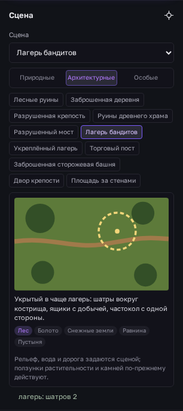
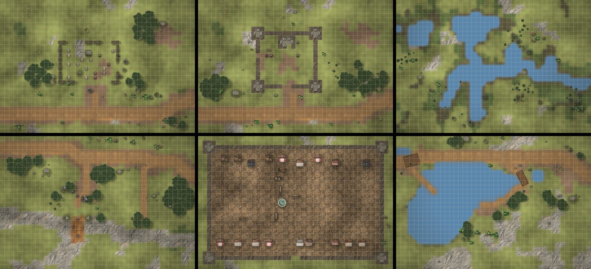

# Сцены-архетипы и природный ландшафт

Описание того, как устроена генерация по сценам-архетипам (Priority 1) и какой
ландшафт под ней лежит (Priority 2). Здесь только реализованное. Что не сделано,
перечислено в конце.





*Слева направо, сверху вниз: кладбище, разрушенная крепость, болотные острова,
вход в пещеру, площадь за стенами, озёрный край.*

## Где включается

- Панель «Генерация» → секция **«Сцена»**. Она показывается для открытых биомов
  (лес, равнина, болото, пустыня, снег) при структурном движке.
- `GenSettings.sceneArchetype`:
  - `'auto'` или отсутствие поля — прежняя генерация, без изменений. Это
    подтверждают золотые сиды в `tests/golden.test.ts`.
  - id из реестра — генерация по сцене.
- Пещеры, склепы и поселения архетипы не используют: `resolveArchetype` для
  этих биомов возвращает `undefined`.

## Модули

| Файл | Что делает |
|---|---|
| `src/lib/gen/heightfield.ts` | Карта высот. Основа — fBm с domain warp и ridged multifractal. Есть 10 типов рельефа: `gentle`, `rolling`, `pass`, `valley`, `basin`, `ridge`, `plateau`, `islands`, `cliffside`, `lakeland`. Термическая эрозия опциональна. |
| `src/lib/gen/hydrology.ts` | Гидрология. Priority-Flood заполняет котловины, D8 задаёт направления стока, считается накопление. Отсюда озёра в котловинах (у каждого есть уровень и сток), реки от истоков по стоку, притоки, ширина по расходу, водосборы, индекс влажности. `hydrologyProblems` ловит подъёмы русла и обрывы. |
| `src/lib/gen/landscape.ts` | `buildLandscape`. Рельеф → вода → обрывы → грунт по влажности, высоте и близости воды → плодородие. Потом 5 проверок с локальными починками: русло течёт вниз и не обрывается, нет одиночных луж, нет островков-обрубков, доля воды в норме, обрывы цельные. Карта целиком не перегенерируется. |
| `src/lib/gen/archetypes.ts` | Реестр из 28 сцен (только данные), совместимость с биомом и цепочка замен. |
| `src/lib/gen/features.ts` | 25 сюжетных построек: лагерь, частокол, руины, крепостные стены, кладбище, вход в пещеру, шахта, разрушенный мост, гати и др. Собираются из обычных объектов редактора: предметов склепа, городских объектов, зданий, руин-структур и сундуков. |
| `src/lib/gen/scenes.ts` | `generateSceneMap` — сборка карты по сцене. |
| `src/components/ScenePanel.tsx` | UI: категории, список, схема-превью, описание, биомы, предупреждение о замене. |

## Конвейер `generateSceneMap`

1. **Ландшафт.** `buildLandscape` получает профиль сцены: `relief`, `water`
   (`none | stream | river | river_wide | lakes | marsh`), `course` (русло
   поперёк или вдоль оси сцены), `cliffs` и `wetlands`. Эрозия включается на
   картах от 1600 клеток.
2. **Фокус.** Это главный визуальный центр. Цель задаёт правило сцены:
   - `center` — центр со сдвигом на `asymmetry`;
   - `thirds` — одна из точек правила третей;
   - `axis` — дно долины или перевала;
   - `crossing` — переправа на главном русле;
   - `cliff` — у скальной стены, по доле скалы в кольце вокруг;
   - `road` — средняя треть тракта.

   Затем рядом с целью ищется место с открытым грунтом нужного радиуса.
3. **Дорога.** Вход и выход выбираются на краях вдоль оси сцены, по низким
   сухим клеткам. Магистраль обходит место сцены стороной, к фокусу ведёт
   ответвление, которое подходит к краю площадки, а не к центру. У переправы
   тракт обязан пройти через точку переправы (waypoint). В режиме `track`
   полотно — утоптанная земля. Прокладывает дорогу прежний `planRoadNetwork`.
   В него добавлены только опции `inland` и `branch`, поток RNG не изменился.
4. **Композиция** (`MapComposition`, тот же формат, что у классического
   генератора):
   - фокус — `battle_area`;
   - второстепенные поляны неравного радиуса. Награда за удалённость
     насыщается, остальное решает шум, поэтому равномерной сетки нет;
   - массы леса. Самая тяжёлая ставится напротив смещения фокуса: кадр
     асимметричный, но уравновешенный. Остальные массы тянутся к плодородным
     местам и расходятся между собой. Для фокуса «на дороге» две массы разного
     размера встают по разные стороны тракта со сдвигом вдоль полотна;
   - каймы-переходы вокруг пространств.
5. **Сюжетные постройки.** Ставятся до растительности. Каждая постройка
   возвращает свои прямоугольники (`footprints`), и лес их обходит
   (`VegetationOptions.reserved`). Если постройка не влезает в желаемое
   место, она сдвигается до 3–5 клеток (`fit`), а не пропадает. Если не
   влезает совсем, это записывается в отчёт сцены.
6. **Растительность.** Прежний `generateStructuredVegetation` получает готовую
   композицию, множители бюджетов сцены (`canopy`, `undergrowth`, `rocks`) и
   плодородие ландшафта. Плодородие модулирует плотность зон. Ползунки
   «Растительность» и «Камни» продолжают действовать.
7. **Общие проходы `generateMap`.** Нормализация, морфология и починка
   (`repairMap`) — те же, что у классической карты. Единственное исключение:
   вода сцены получена гидрологией, поэтому нормализация убирает только
   крошки до 3 клеток (`plan.archetype` присутствует).

Каждый слой берёт свой поток `SeededRandom`: `0x5ce7e` для фокуса, `5171` для
дороги, `0x7a11` для концов дороги, `0xc0b0` для композиции, `0xfea7` для
построек.

## Как добавить сцену

Добавьте одну запись в `SCENE_ARCHETYPES`:

```ts
{
  id: 'smugglers_cove', category: 'natural', label: 'Бухта контрабандистов',
  description: '…', biomes: ['forest', 'plains', 'swamp'], fallback: 'lakeland',
  relief: 'basin', water: 'lakes', course: 'none', cliffs: 0.4, wetlands: 0.2, road: 'track',
  vegetation: veg(0.9, 1, 1), composition: comp('cliff', 0.12, 1, 2, 1, 0.4), features: ['camp_tents'],
}
```

После этого:

- UI покажет сцену в списке, а превью нарисуется из этих же данных;
- тест `tests/scenes.test.ts` проверит её на детерминизм, валидность проекта,
  свободный фокус, отсутствие объектов в воде и проверки рельефа.

Если нужна новая постройка, добавьте `FeatureId` и функцию в `FEATURES`.
Тест проверяет, что у каждой постройки из реестра есть функция-сборщик.

## Совместимость и формат

- `GenSettings.sceneArchetype?: string` — опциональное поле. Старые проекты без
  него загружаются как есть. Неизвестный id отклоняется валидацией.
- `GenerationPlan.archetype?: ArchetypeReport` — отчёт сцены: какая сцена
  применена, что запросили, цепочка замен, фокус, число пространств и масс,
  заметки построек, сводка ландшафта и проверки. План в проект не
  сохраняется, поэтому формат файла не меняется.
- Предметы склепа под открытым небом допустимы на естественном грунте
  открытых биомов (`cryptGround`). В склепе правило прежнее: только пол.
- Рыночные спрайты теперь загружаются и для сцен с городскими объектами
  (торговый пост, лагерь, кладбище).

## Проверки

```bash
npm test          # vitest (золотые сиды, сцены, ландшафт, хранилище) + скриптовые тесты
npm run typecheck
```

Замеры: Node 20, прогретый JIT, медиана по 3 сидам.

| Карта | Время |
|---|---|
| классика, лес 36×22 | 75 мс |
| классика, лес 100×80 | 234 мс |
| сцена «Поляна» 36×22 | 31 мс |
| сцена «Поляна» 100×80 | 295 мс |
| сцена «Лесная засада» 100×80 | 236 мс |
| сцена «Горная долина» 100×80 | 217 мс |
| сцена «Площадь за стенами» 100×80 | 236 мс |

## Ограничения

- Превью в панели — схема замысла сцены (рельеф, вода, дорога, массы,
  фокус), а не уменьшенная карта конкретного seed.
- Для одного seed сцены с одинаковым типом рельефа получают одинаковую
  форму местности. Различаются вода, дорога, композиция и постройки.
- Гати (`boardwalks`) рисуются клетками `bridge`. Отдельного настила для них
  нет, отрисовка — общая для клеток моста.
- В «Площади за стенами» и «Дворе крепости» стены занимают почти всю карту.
  Это решение сцены, а не баг.
- Отдельных настроек у сцены нет намеренно: композиция автоматическая.
  Переключатель «Дорога к месту сцены» показывается только у сцен с
  необязательной дорогой.
